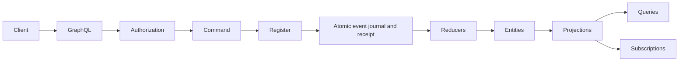

# Booster Java

**Work in progress in PR #1607.** The required goal includes the Azure provider,
advanced projections, data migrations, existing API/authentication/subscription
compatibility, and Java webhook and file-upload rockets. AWS is excluded.
The implementation described below is the verified local foundation; it is not
the completed port. Track the remaining requirements in [GOAL.md](GOAL.md).

An independent Java edition of Booster: commands produce durable events, pure
reducers reconstruct entities, and projections build queryable read models.
Applications use Java records and typed handlers. The existing TypeScript
implementation and its build are untouched.

**Requires JDK 27.** No preview features, Node.js, Docker, cloud account, or
external database are required for the local runtime. Maven 3.10.0 is pinned by
the checksum-verifying `mvnw` launcher.

See [the goal](GOAL.md), [compatibility](COMPATIBILITY.md), and
[validation results](VALIDATION.md) for the scope and evidence behind this edition.

## Build and test

```sh
cd java
# Optional on Linux x86_64 if a JDK 27 is not already installed:
./scripts/install-jdk.sh
export JAVA_HOME="$PWD/.tools/jdk-27.0.1.0.3"
export PATH="$JAVA_HOME/bin:$PATH"
./mvnw verify
```

The optional script installs a checksum-verified Oracle JDK 27.0.1.0.3 into
the ignored `.tools` directory. You can instead set `JAVA_HOME` to another JDK
27 distribution. The Maven launcher uses that setting, the locally bootstrapped
JDK, or the system Java installation. TLS and artifact checksum verification
remain enabled.

`verify` compiles the framework and runs unit and integration tests. The normal
library JAR and an executable JAR containing its dependencies are generated in
`target/`. Install the library into your local Maven repository before building
a generated application:

```sh
./mvnw install
```

## Run a real application

```sh
java -jar target/booster-java-0.1.0-SNAPSHOT-all.jar demo --port 3000 --data .data/cart
```

The shopping-cart example binds to loopback. It defines open, add, remove and
checkout commands, immutable domain events, a cart entity, and a cart projection.
Its journal is an H2 database in the chosen data directory. The example
explicitly permits anonymous access so that it can be exercised immediately.

In a separate terminal, send GraphQL requests:

```sh
curl --fail-with-body http://127.0.0.1:3000/graphql \
  -H 'Content-Type: application/json' -H 'Idempotency-Key: cart-open-1' \
  --data '{"query":"mutation { OpenCart(input: {cartId: \"cart-1\"}) { id } }"}'

curl --fail-with-body http://127.0.0.1:3000/graphql \
  -H 'Content-Type: application/json' -H 'Idempotency-Key: cart-add-1' \
  --data '{"query":"mutation { AddItem(input: {cartId: \"cart-1\", sku: \"book\", quantity: 2, unitPriceCents: 1500}) { id } }"}'

curl --fail-with-body http://127.0.0.1:3000/graphql \
  -H 'Content-Type: application/json' \
  --data '{"query":"{ CartView(id: \"cart-1\") { id totalQuantity totalCents checkedOut } }"}'
```

The view contains `totalQuantity: 2` and `totalCents: 3000`. Repeating the same
mutation with the same idempotency key returns the original result without
adding events. A changed request with that key is rejected. Stop and restart
the server with the same `--data` directory; the view is reconstructed from the
persisted journal. Keep one local server per embedded database file.

```sh
curl --fail-with-body http://127.0.0.1:3000/health
# After stopping the server:
java -jar target/booster-java-0.1.0-SNAPSHOT-all.jar replay --data .data/cart
```

`start` is an alias for running the bundled example. An independently generated
application has its own main class.

## Create an application

```sh
java -jar target/booster-java-0.1.0-SNAPSHOT-all.jar new /tmp/my-cart --package com.example.cart
cd /tmp/my-cart
mvn verify
mvn exec:java
```

Use Maven with JDK 27 in the new project. The generator refuses to overwrite an
existing destination and creates source code, tests, a Maven build and a README.
The framework artifact currently resolves from your local Maven repository
after `./mvnw install`; it is not published to Maven Central.

## Application model

The shopping-cart example in
[`ShoppingCartApplication.java`](src/main/java/io/boostercloud/booster/example/ShoppingCartApplication.java)
is a complete reference. Applications register their contracts explicitly:

```java
Booster.builder(store)
    .entity(Cart.class)
    .event(CartOpened.class, CartOpened::cartId, Cart.class,
        (event, previous) -> new Cart(event.cartId(), List.of(), false))
    .command(OpenCart.class, CartId.class, AccessPolicy.publicAccess(),
        (command, register) -> {
          if (register.entity(Cart.class, command.cartId()) != null) {
            throw new IllegalArgumentException("Cart already exists");
          }
          register.emit(new CartOpened(command.cartId()));
          return new CartId(command.cartId());
        })
    .readModel(CartView.class, Cart.class, AccessPolicy.publicAccess(),
        (cart, previous) -> new CartView(cart.id(), 0, 0, false))
    .build();
```

This fragment illustrates registration; the complete example implements all
business invariants and projections. Registrations, record types, and handlers
are Java code, with no runtime dependency on TypeScript decorators or metadata.



## Persistence and concurrency

`EventStore` is a small transactional provider contract. `JdbcEventStore` uses
H2 with a versioned schema, atomic journal-and-receipt commits and optimistic
aggregate versions. It serializes journal positions across concurrent store
instances. `InMemoryEventStore` supplies an isolated implementation for tests.
Persist only events and receipts; entities and projections are derived state.

Command handlers buffer events. A failed handler does not append that buffer.
Expected versions prevent two competing writes from silently losing updates.
An optimistic version conflict can be retried after re-reading current state.
An idempotency-key conflict means that key already identifies a different
request: reconcile the original operation instead of automatically assigning a
new key and potentially duplicating it. Do not perform irreversible external
side effects inside a handler that may be retried.

Reducers and projections must be pure: the runtime validates pending state
before committing and evaluates it again during replay. Once a commit succeeds,
later handler or hook failures do not roll it back. The runtime reports those
errors through `onError` and can retry unfinished durable event handlers with
`resumeHandlers()`.

Local derived views are rebuilt from the journal and should fit in memory.
The current provider is intended for local applications and embedded workloads,
not a distributed cloud deployment. See the compatibility matrix for delivery,
projection and scheduling guarantees and boundaries.

## GraphQL and authentication

GraphQL Java parses and validates operations, variables, fragments and selection
sets. Record components define typed command inputs and result objects. Read
models expose by-ID fields and paginated `List<PluralName>` fields. The transport
limits request size, query depth and complexity, and sanitizes internal errors.

Policies are explicit: `AccessPolicy.deny()`, `publicAccess()`, `authenticated()`
or `roles("admin")`. Operations using the default policy deny access. A custom
policy can inspect the authenticated user's claims.

The transport has a configurable authenticator and an RS256 JWT verifier. The
verifier checks the signature, issuer, audience, subject, expiration and token
time constraints using a configured RSA public key of at least 2048 bits. Raw
identity headers do not establish authentication. Applications manage their
trusted key configuration and rotation; automatic JWKS discovery is not provided.

```java
var verifier = new JwtVerifier(trustedRsaPublicKey, "https://issuer.example", "my-api");
var server = new BoosterHttpServer(booster, 3000)
    .authentication(AuthenticationProvider.jwt(verifier));
server.start();
```

The verifier and authentication provider are in the `transport.auth` and
`transport` packages respectively. Supply the trusted key from your application's
configuration. The example CLI does not provision an identity provider.

Subscriptions use GraphQL execution with a reactive publisher and the HTTP
Server-Sent Events transport. This is not the TypeScript provider's WebSocket
protocol. Check the compatibility matrix before connecting an existing client.

## Development boundaries

All Java source, tests, tool launchers and documentation are under this directory.
Running the Java build does not install npm packages or invoke Rush. AWS/Azure
deployment and the npm Rocket ecosystem are not included in the local Java
provider. These are explicit extension boundaries, not commands that pretend to
deploy. The Java implementation is a separate API and storage format; do not
point it at existing TypeScript provider data.

Proxy-based development environments may need Maven `settings.xml` proxy
configuration and the environment CA in Java's truststore. Supply these through
standard Maven/JVM options; never disable certificate or checksum verification.
